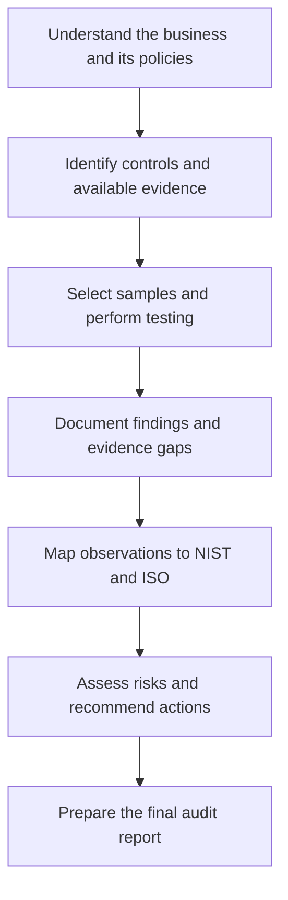

HarborCart Cybersecurity GRC Audit
A practical audit of IT controls, security risks, and compliance gaps
IT General Controls | NIST CSF 2.0 | ISO/IEC 27001:2022 | Cyber Risk Assessment

Audit period: 1 November 2025 to 31 October 2026
Evidence cutoff: 31 October 2026
Report status: Management validation pending

Project overview · Audit approach · Results · Project files

About this project: HarborCart Commerce is a fictional company. Every policy, identity, system record, and security event used here is synthetic. This is a portfolio case study, not an audit or certification opinion about a real organization.

Project overview
I created this project to work through the cybersecurity audit process in a realistic business setting. HarborCart is a fictional online retailer with cloud infrastructure, employee identities, development pipelines, customer information, and the day to day security challenges that come with running those systems.

The work starts with company policies and simulated system evidence. From there, I examined how selected security controls were designed, checked whether they were operating as expected, documented the exceptions, and assessed the risks. I then mapped the observations to NIST CSF 2.0 and ISO/IEC 27001:2022 and brought the results together in an audit report with recommended next steps.

The aim was not simply to identify missing controls. It was to show how an auditor can connect a policy requirement to actual evidence, explain the business impact of a gap, and make a recommendation that can be tested later.
Project at a glance
Area	Details
Business setting	Fictional online retail and fulfillment company based in India
Systems reviewed	Microsoft Entra ID, AWS, GitHub Enterprise Cloud, ServiceNow, and Microsoft Sentinel
ITGC testing	20 control tests documented in the audit workpapers
NIST CSF 2.0	Six functions and 22 categories, with detailed outcome mapping
ISO/IEC 27001:2022	Assessment of 93 Annex A controls and ISMS clauses 4 to 10
Risk assessment	Likelihood and impact scored on a 5 × 5 matrix
Main deliverables	Evidence workbook, audit workpapers, risk assessment, and final audit report
Current status	Findings await management validation; remediation has not been verified

What the audit covers
The scope includes people, processes, and technology controls. I focused on whether the controls described in HarborCart's policies were supported by the available evidence.

<strong>View the full audit scope</strong>

Control area	What I looked for
Employee access	Approved access for new joiners, role changes, and timely removal after departure
Authentication	MFA coverage, privileged role assignments, and access exceptions
Access reviews	Completed reviews, reconciled permissions, and follow up on overdue items
Change management	Approvals, testing, and rollback plans for normal and emergency changes
Software development	Pull request reviews, branch protection, and successful CI checks
Production releases	A clear link between deployments and approved ServiceNow changes
Cloud security	AWS configuration, storage exposure, encryption, and logging
Vulnerability management	Remediation within policy timelines and review of aged access keys
Monitoring	Log collection, retention, alert handling, and connector health
Incident response	Investigation, containment, documentation, and privacy escalation
Backup and recovery	Backup failures, restoration testing, and recovery objectives
Supplier and privacy controls	Vendor reviews, processing agreements, privacy requests, and data retention
People and physical security	Awareness training and removal of facility access after departure

Audit approach
I used a straightforward sequence: understand the control, find relevant evidence, test what happened, and document the result. Where the records did not support a firm conclusion, I called out the limitation instead of treating an assumption as a fact.

How I worked through the evidence
1. Set the criteria. I used the fictional policy pack to identify what each control was supposed to achieve.
2. Understand the populations. I reviewed the available HR, identity, change, code, cloud, monitoring, and incident records.
3. Test the controls. I checked selected records against the policy requirements, considering design and operating effectiveness separately.
4. Document the exceptions. I recorded the condition, relevant evidence, business risk, and proposed corrective action.
5. Assess the wider gaps. I mapped the results to NIST CSF 2.0, ISO/IEC 27001:2022, and the cyber risk register.
6. Report what matters. I prioritized the observations and prepared an executive report with limitations and a proposed remediation plan.

<strong>Evidence limitations and how they were handled</strong>

- The evidence consists of simulated policies, records, exports, and workpapers.
- The Entra sign in and AWS CloudTrail records include samples rather than complete event populations.
- Some timestamps and data relationships need additional reconciliation.
- Proposed root causes are not treated as confirmed unless the supporting evidence establishes them.
- A recommendation or an assigned due date does not mean a finding has been resolved.
- Conclusions apply only to the controls and evidence included in this case study.

Audit results
The final report documents 25 findings. Based on the supplied evidence, it concludes that the selected ITGC controls were not operating effectively. This is a conclusion about the tested scope, not every control across the fictional business.
Findings by severity
Severity	Number of findings	Share of total
Critical	3	12%
High	10	40%
Medium	10	40%
Low	2	8%
Total	25	100%

Three critical findings
These examples show how the audit connects a control failure to a practical business risk and an action that management could take.

<strong>FND-001: Access remained active after employees left</strong>

What I found
Four former employees still had enabled accounts after their departure dates. The available records also showed sign ins after employment had ended.

Why it matters
Accounts that remain active can provide unauthorized access to business systems and customer information.

Recommended action
Disable the accounts, review related activity, and connect the HR departure process to account deactivation with alerts for overdue requests.

Evidence note
The report flags the elapsed day calculations for reconciliation.

<strong>FND-002: Privileged access lacked appropriate safeguards</strong>

What I found
Several privileged roles were permanently assigned, with no recorded review. Two Global Administrator accounts did not have MFA registered in the supplied evidence.

Why it matters
Compromise of a highly privileged account could give an attacker extensive control over the identity environment.

Recommended action
Review standing privileges, use Microsoft Entra Privileged Identity Management for eligible access, and require strong MFA for administrators.

<strong>FND-003: Customer export storage was publicly accessible</strong>

What I found
The synthetic evidence identified publicly accessible, unencrypted customer export storage. The associated potential privacy incident was not escalated within the timeframe required by the fictional policy.

Why it matters
Customer information could be exposed, creating privacy, operational, and reputational risks.

Recommended action
Restrict public access, preserve relevant logs, investigate the activity, and involve the Legal and Privacy team.

Evidence note
The actor attribution and extent of data access require confirmation from native logs. The report does not establish that data was exfiltrated.

Framework assessments
The frameworks helped organize the results and identify where the fictional company had stronger documented policies than evidence of consistent execution.

<strong>NIST CSF 2.0 assessment</strong>

The review covers all six functions: Govern, Identify, Protect, Detect, Respond, and Recover.

The most significant gaps appeared in identity and access management, data protection, security monitoring, incident analysis, and incident communication. Policies and general awareness were comparatively stronger than detection, response, and recovery practices.

The workpapers use an internal maturity scale from 0 to 4. These scores are not official NIST Implementation Tiers or compliance percentages. The detailed outcome mapping should not be mistaken for 106 independently performed tests.

<strong>ISO/IEC 27001:2022 assessment</strong>

The workpapers assess the applicability and recorded implementation status of the 93 Annex A controls, along with gaps in ISMS management system clauses.
Recorded status	Number of controls
Yes	6
Partial	42
No	11
Not evidenced	33
Not applicable	1
Total	93

A control marked Yes is not automatically effective in practice. Likewise, Not evidenced does not necessarily mean a control is absent. The available material does not support a certification readiness or conformity opinion.

Recommended remediation priorities
I grouped the recommendations into practical timeframes based on how quickly the risks should be addressed. These are proposed priorities from the report, not confirmed management commitments.
Timeframe after approval	Recommended focus
First 2 days	Contain the customer export exposure, preserve evidence, involve Legal and Privacy, disable inappropriate access, and secure administrator accounts.
Within 7 days	Restore cloud log ingestion, review outstanding security alerts, and address critical cloud configuration and vulnerability issues.
Within 30 days	Strengthen change approval and deployment controls, address stale AWS keys, resolve backup issues, and complete priority restore tests.
Within 90 days	Improve employee access workflows, complete overdue supplier and privacy actions, and establish recurring control monitoring and management review.

Follow up matters. Some original target dates in the report had already passed by the time the report was prepared. The actions need confirmed owners, evidence of implementation, and retesting before any finding can be considered closed.
Project files
The repository is organized in the same order that I would review the audit: business context first, source evidence next, then the workpapers and final report.
HarborCart-GRCAudit/
│
├── README.md
│
├── 01-case-background/
│   └── CompanyPolicy.docx
│
├── 02-evidence/
│   └── EvidenceData.xlsx
│
├── 03-audit-workpapers/
│   └── WorkPapers.xlsx
│
└── 04-final-report/
    └── AuditReport.docx
Document	What you will find
[Company policy and case background](01-case-background/CompanyPolicy.docx)	The fictional company profile, systems, policies, and control expectations.
[Synthetic evidence data](02-evidence/EvidenceData.xlsx)	Simulated system exports used to assess the selected controls.
[Audit workpapers](03-audit-workpapers/WorkPapers.xlsx)	ITGC testing, observations, framework mapping, and cyber risk assessment.
[Final audit report](04-final-report/AuditReport.docx)	The executive conclusion, findings, evidence limitations, and recommended actions.

Suggested reading order
1. Start with CompanyPolicy.docx to understand the business and control requirements.
2. Open EvidenceData.xlsx to see the records used for testing.
3. Follow the analysis in WorkPapers.xlsx.
4. Read AuditReport.docx for the overall conclusions and recommendations.
Skills demonstrated
This case study brings together audit judgment, technical evidence review, and clear reporting. The main areas of practice include:
- Testing IT general controls for design and operating effectiveness.
- Reviewing identity management, MFA, privileged access, and access certifications.
- Tracing production changes through ServiceNow, GitHub, and deployment evidence.
- Assessing AWS configuration, credentials, vulnerabilities, logging, and recovery controls.
- Mapping observations to NIST CSF 2.0 and ISO/IEC 27001:2022.
- Building a risk register and prioritizing recommended treatment.
- Writing audit findings that connect criteria, evidence, risk, and corrective action.
- Explaining evidence limitations and presenting results for management review.
Final note
HarborCart Commerce and its supporting records are entirely fictional. This project is a training and portfolio exercise, not a production investigation, penetration test, certification audit, or assurance engagement.

For me, the central lesson of this work is that a documented security control is not the same as a control that operates effectively. The important part of an audit is being able to show what the evidence supports, where it falls short, and what should happen next.

Back to top

