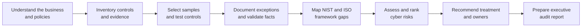

<h1 align="center">HarborCart | Cybersecurity GRC Audit</h1>
<strong>An end-to-end cybersecurity governance, risk, and compliance audit simulation</strong>

<em>IT General Controls (ITGC) | NIST CSF 2.0 | ISO/IEC 27001:2022 | Enterprise Cyber Risk</em>

  
  
  

<strong>Assessment period:</strong> 01 Nov 2025 - 31 Oct 2026 &nbsp; | &nbsp; <strong>Evidence cutoff:</strong> 31 Oct 2026

  <a href="#project-overview">Explore the case</a> | <a href="#audit-methodology">Review the methodology</a> | <a href="#audit-results">See the findings</a> | <a href="#repository-structure">Browse the files</a>

[!IMPORTANT]
Portfolio simulation only. HarborCart Commerce is a fictional e-commerce business. All identities, customer records, policies, transactions, logs, and security events in this project are synthetic. The work does not represent an audit of a real organization or an assurance or certification opinion.

Project overview
HarborCart is a fictional, India-focused e-commerce marketplace designed to provide a realistic setting for a full-cycle cybersecurity audit. This project evaluates control design and operating effectiveness using simulated policies, system exports, test samples, and workpapers.

The objective is to connect audit evidence to meaningful security outcomes: identify control gaps, assess cyber risk, map observations to recognized frameworks, and develop prioritized remediation recommendations that management could evaluate.
Project at a glance
Dimension	Coverage
Business scenario	Fictional e-commerce and fulfillment operations
Core systems	Microsoft Entra ID, AWS, GitHub Enterprise Cloud, ServiceNow, Microsoft Sentinel
Audit lens	Governance, identity, access, change, cloud security, monitoring, recovery, privacy, and third-party risk
Testing	20 ITGC tests documented in the workpapers
Frameworks	NIST CSF 2.0 (6 functions, 22 categories), ISO/IEC 27001:2022 (93 Annex A controls and clauses 4-10)
Risk approach	5 x 5 likelihood-impact scoring, inherent risk, proposed treatment, and planned residual risk
Deliverables	Control testing, evidence analysis, framework assessments, risk register, observation register, and executive audit report
Current report status	Management validation pending; remediation completion not verified

Explore the audit

<strong>1. Scope of the assessment</strong> (click to expand)

The assessment spans selected people, process, and technology controls:
Focus area	Example control questions
Identity lifecycle	Are joiners, movers, and leavers provisioned, approved, and disabled on time?
Authentication and privilege	Is MFA enforced and is privileged access limited, reviewed, and time-bound?
Access governance	Are quarterly access reviews completed and exceptions reconciled?
Change management	Are normal and emergency changes approved and documented?
Secure development and releases	Are pull requests reviewed, CI checks enforced, and deployments tied to approved changes?
Cloud configuration	Are AWS resources protected by appropriate access, encryption, and logging controls?
Vulnerabilities and credentials	Are weaknesses remediated within policy SLAs and long-lived keys controlled?
Security monitoring	Are logs collected, retained, and assessed for actionable alerts?
Incident response	Are incidents triaged, investigated, and escalated appropriately?
Backup and recovery	Are failures resolved and recovery capabilities tested against objectives?
Supplier and privacy governance	Are suppliers assessed, privacy requests processed, and retention rules defined?
People and physical security	Is awareness training completed and facility access revoked on departure?

<strong>2. Frameworks and evaluation approach</strong> (click to expand)

Framework / discipline	How it is applied
ITGC	Evaluate documented control design, select evidence samples, test execution, and record exceptions.
NIST Cybersecurity Framework 2.0	Assess Govern, Identify, Protect, Detect, Respond, and Recover against a current and target profile.
ISO/IEC 27001:2022	Evaluate Annex A control applicability / implementation evidence and review ISMS management-system clauses.
Cyber risk assessment	Score scenarios by likelihood x impact, identify owners, and prioritize proposed risk treatment.

Interpretation matters: the NIST workbook uses an internal 0-4 maturity scale, not an official NIST implementation tier or compliance percentage. ISO implementation statuses are workpaper judgments, not proof of conformity or certification readiness.

<strong>3. Evidence and testing limitations</strong> (click to expand)

- Evidence consists of intentionally simulated policies, data exports, workpapers, and event samples.
- Selected sign-in and CloudTrail events are samples, not guaranteed complete log populations.
- Some event timestamps and records require reconciliation or independent corroboration.
- Root causes may be hypotheses until verified; proposed remediation is not evidence of completed remediation.
- The final audit report explicitly limits conclusions to the audited scope and supplied evidence.

Audit methodology
The engagement follows an evidence-led sequence from understanding the environment to recommending corrective action.

What the workpapers demonstrate
1. Translate policies into measurable audit criteria and define relevant evidence populations.
2. Review control design separately from how controls actually operated.
3. Join HR, identity, ITSM, code, cloud, and monitoring records to test cross-system workflows.
4. Document conditions, risks, evidence references, and potential causes without overstating certainty.
5. Map control observations to NIST CSF 2.0 and ISO/IEC 27001:2022.
6. Prioritize remediation through inherent risk, proposed treatment, and follow-up testing expectations.
7. Communicate results in a management-oriented audit report.
Audit results
The supplied report records 25 observations across four severity levels. Its executive conclusion is that the selected ITGCs were not operating effectively within the tested scope; this is not a conclusion about every control in the fictional enterprise.
Severity	Findings	Share
Critical	3	12%
High	10	40%
Medium	10	40%
Low	2	8%
Total	25	100%

<strong>View the three critical findings</strong>

ID	Observation	Primary risk	Recommended direction
FND-001	Leaver accounts remained active after departure, with post-exit sign-ins documented.	Former employees could retain access.	Disable and investigate accounts; automate HR-to-identity offboarding and SLA alerts.
FND-002	Permanent privileged Entra roles lacked appropriate MFA / PIM controls.	A compromised administrator account could lead to tenant takeover.	Review or remove standing privilege, enforce strong MFA, and use time-bound PIM.
FND-003	A customer-export storage resource was publicly accessible and a potential PII incident was not escalated as required.	Possible exposure of customer information.	Restrict exposure, preserve evidence, investigate access, and involve Legal & Privacy.

Evidence caution: The FND-001 elapsed-day figures require reconciliation; the actor attribution and extent of access for FND-003 require native-log corroboration. Data exfiltration has not been established.

<strong>View the framework assessment snapshot</strong>

NIST CSF 2.0: Priority gaps appear in identity and access, data security, continuous monitoring, incident analysis, and incident communications. Governance policies and awareness compare more favorably than operational execution. Detailed outcomes are not 106 separate audit tests.

ISO/IEC 27001:2022 Annex A: The workpaper records the following implementation labels across 93 controls:
Recorded status	Count
Yes (Y)	6
Partial	42
No (N)	11
Not evidenced	33
Not applicable (N/A)	1

An item marked not evidenced is not automatically absent; an item marked yes is not automatically operating effectively. The supplied materials do not support an ISO certification-readiness opinion.

Proposed remediation roadmap
Window after approval	Priority actions
0-2 days	Contain potential customer-export exposure; preserve relevant records; involve Legal & Privacy; disable inappropriate access and secure privileged identities.
Within 7 days	Restore critical log ingestion and alert coverage; investigate open high-priority security alerts; triage exposed cloud configurations and critical vulnerabilities.
Within 30 days	Enforce approved-change, repository, and CI gates; address aged cloud keys; document backup resolutions and conduct priority restore testing.
Within 90 days	Automate identity lifecycle and access reviews; improve vendor and privacy governance; establish control KPIs and management review evidence.

[!NOTE]
These are proposed actions, not management-approved commitments or verified fixes. The source report retains earlier original target dates and calls for owner confirmation, remediation evidence, and independent retesting before closure.

Repository structure
The project files are arranged so each audit stage can be reviewed independently.
HarborCart-Cybersecurity-GRC-Audit/
|
|-- README.md
|-- 01-case-background/
|   `-- CompanyPolicy.docx          # Fictional company brief and policy criteria
|-- 02-evidence/
|   `-- EvidenceData.xlsx           # Synthetic control-testing evidence
|-- 03-audit-workpapers/
|   `-- WorkPapers.xlsx             # ITGC tests, framework mapping, risk and findings
`-- 04-final-report/
    `-- AuditReport.docx            # Executive conclusions and remediation plan
Resource	What to review
[Company case and policy pack](01-case-background/CompanyPolicy.docx)	Background, organizational context, architecture, policies, and control expectations.
[Synthetic evidence workbook](02-evidence/EvidenceData.xlsx)	Structured simulated exports used as testing evidence.
[Audit workpapers](03-audit-workpapers/WorkPapers.xlsx)	Sample testing, ITGC results, NIST / ISO mapping, findings, and cyber risk analysis.
[Final audit report](04-final-report/AuditReport.docx)	Executive summary, critical observations, limitations, and treatment recommendations.

Suggested review path
Start with the policy criteria -> inspect the synthetic evidence -> trace testing in the workpapers -> evaluate conclusions in the final report.
Skills demonstrated
Assurance and GRC	Technical security and analysis
ITGC control design and operating effectiveness testing	Identity lifecycle, privilege, MFA, and access review testing
Audit planning, sampling, and evidence traceability	Secure SDLC, CI / CD, and production change testing
Observation and exception documentation	AWS configuration, credentials, and vulnerability assessment
NIST CSF 2.0 current-state gap analysis	SIEM logging, alerting, and incident response assessment
ISO/IEC 27001:2022 control mapping and SoA review	Backup, restoration, and resilience testing
Enterprise cyber risk assessment and treatment planning	Privacy, vendor, awareness, and physical security controls
Remediation design and retesting expectations	Cross-system data correlation and evidence quality review
Executive-level cybersecurity reporting	Risk-based prioritization and stakeholder communication

Disclaimer and responsible interpretation
HarborCart Commerce is entirely fictional. The organization, records, personal details, system activity, policies, findings, and scenarios have been fabricated solely for cybersecurity training and portfolio demonstration.

This repository is not a real-world penetration test, a production-system investigation, a certification audit, or an assurance opinion on any actual business. Findings are scoped to the simulated records; some event exports are incomplete samples, and management validation and remediation verification remain outstanding.

The intent is to demonstrate a defensible, evidence-based GRC audit workflow: criteria -> testing -> observation -> risk -> recommendation -> follow-up.

<strong>Built as a practical cybersecurity GRC portfolio case study.</strong>

<a href="#top">Back to top</a>

